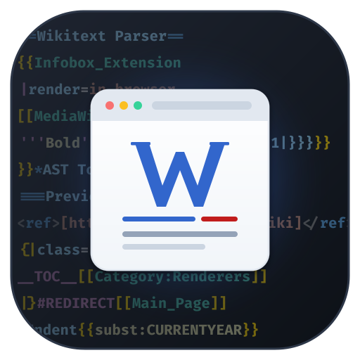
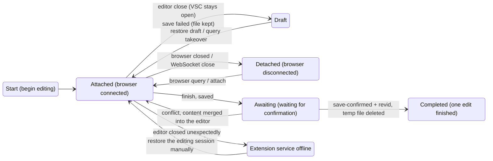

<div align="center">



# WikiPreviewer

English | [简体中文](README.zh.md)

### Your live edits, rendered straight in the browser

A combined InPageEdit + VSCode Plugin project that uses VSCode as the editor and the browser as the renderer.

<p align="center">
  <a href="https://github.com/minortex/WikiPreviewer/releases/latest"></a>
  <a href="https://marketplace.visualstudio.com/items?itemName=minortex.wiki-previewer"></a>
  <!-- <a href="https://marketplace.visualstudio.com/items?itemName=minortex.wiki-previewer"></a> -->
  <a href="https://open-vsx.org/extension/minortex/wiki-previewer"></a>
  <br>
  <a href="LICENSE"></a>
  <a href="https://github.com/minortex/WikiPreviewer/actions/workflows/build-dev.yml"></a>
  <a href="https://minortex.github.io/WikiPreviewer/ipe-plugin/registry.json"></a>
</p>

</div>

## Installation

### VSIX

- [open-vsx.org](https://open-vsx.org/extension/minortex/wiki-previewer)

- [vscode-marketplace](https://marketplace.visualstudio.com/items?itemName=minortex.wiki-previewer)

### IPE NEXT plugin

Install IPE first by following the [IPE installation guide](https://www.ipe.wiki/guide/installation),
then add the registry in InPageEdit Settings → Plugin Store:

```
https://minortex.github.io/WikiPreviewer/ipe-plugin/registry.json
```

Development version:
```
https://minortex.github.io/WikiPreviewer/ipe-plugin/dev/registry.json
```

After installing:

- Allow access to local devices so the plugin can connect to the local service the extension starts.
- To jump to definitions from VSCode, allow the page to open in the browser the first time.

## Usage

The extension leads, because it is what actually holds the user's unsaved changes; the web page only pushes site content and renders it, attaching to the extension so it can be closed at any time.

1. Web side:
   - Click the extra fifth grey button to edit the whole page.
   - Click "Save changes" to submit.
   - Click "Cancel": with no changes the original page is restored and the editor closes automatically; with changes it asks whether to save.
   - Multiple tabs of the same page can attach to one editing session: editor updates are pushed to every attached tab, and saving or cancelling in any tab ends that session.

2. Extension side:
- Editing commands:
  - Close editor / close editing session:
    - When the content differs from the original page, ask whether to save or discard.
    - When nothing changed, close the editor tab and delete the temp file directly.
    - Closing also tries to close the browser page spawned for the session.
    - If the editor exits unexpectedly and is reopened, editor tabs restored by VSCode keep working as sessions.
  - Restore editing draft:
    - If a draft was not restored for some reason, read it from the local file and restore the editing session manually.
  - Save the current file via IPE:
    - Same as "Save changes" on the web side.
    - If an edit conflict occurs on save, the conflict markers are written into the editor for manual merging.
  - Open the current page in the browser.

If you want to understand the four state transitions...

<details>
<summary>Expand</summary>



| State | Meaning |
|---|---|
| `Attached` | The browser WebSocket is connected and the current window is being edited |
| `Detached` | The session still exists, but the browser connection has dropped |
| `Draft` | The VSCode editor was closed; the temp file is kept as a draft |
| `Awaiting` | Submitted successfully, waiting for the browser to confirm with the new revision id (revid); the temp file is deleted only after that confirmation |

</details>

## Multiple wikis

- Once connected to the extension, the web-side script requests the local site's `siteinfo` with the browser's login state and pushes it to the extension through the `register-wiki` message.
- The command palette lists the wikis that have been connected.

Temp files are laid out per site host: `<tempDir>/<host>/<page name>[.s<section>].<timestamp>.wiki`.

## Language features

Powered by `wikiparser-node`: diagnostics and quick fixes, syntax/semantic highlighting, completion, hover, signature help, folding, outline, internal links, definitions/references/rename. Go-to-definition opens the target page in the browser; references and rename are limited to the current document.

Beyond wikiparser's context completion, completion also offers structural snippets: headings, tables, quotes, tags, redirects, signatures, comments and more. Accepting a parser-function completion (`#if`, `#switch`, `#invoke`, …) generates a skeleton with parameter placeholders. `{{{`, `{{`, `[[`, `{|`, `<!--` and `-{` auto-close; no snippets are offered inside `<nowiki>`, `<pre>`, comments and similar regions.

## Position sync

The web page follows the cursor position, and double-clicking in the page syncs that position back to the editor.

Heuristic matching, because Parsoid breaks the layout and DSR has almost no wiki support for precise positioning.

- Editor → preview: AST text node + section + occurrence, located inside the same section of the preview.
- Preview → source: text at the click point + section + occurrence, looked up in reverse; falls back to line-by-line text matching on failure.
- Textless templates: matched against expanded blocks by template name/parameters/section/index; falls back to highlighting the whole section.

Most cases do jump, but complex layouts can still break forward or reverse matching.

## UI language

Runtime messages have English as their source and switch automatically with VS Code's display language through `vscode.l10n`; Simplified Chinese is bundled today (`l10n/bundle.l10n.zh-cn.json`). Manifest text such as command titles and settings uses `package.nls*.json`.

To add a language, copy `l10n/bundle.l10n.zh-cn.json` to the matching locale file (e.g. `bundle.l10n.ja.json`) and translate the values; keys must match the English source strings exactly. To change the VS Code display language, run "Configure Display Language" from the command palette.
