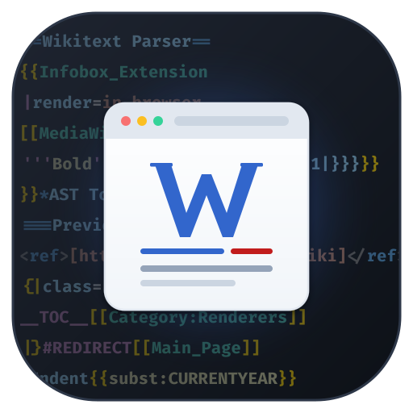
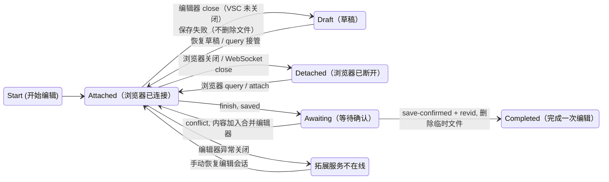

<div align="center">



# WikiPreviewer

[English](README.md) | 简体中文

### 让你的实时编辑在浏览器上直接渲染

用 VSCode 作为编辑器，把浏览器当做渲染器的 InPageEdit+VSCode Plugin 组合项目。

<p align="center">
  <a href="https://github.com/minortex/WikiPreviewer/releases/latest"></a>
  <a href="https://marketplace.visualstudio.com/items?itemName=minortex.wiki-previewer"></a>
  <!-- <a href="https://marketplace.visualstudio.com/items?itemName=minortex.wiki-previewer"></a> -->
  <a href="https://open-vsx.org/extension/minortex/wiki-previewer"></a>
  <br>
  <a href="LICENSE"></a>
  <a href="https://github.com/minortex/WikiPreviewer/actions/workflows/build-dev.yml"></a>
  <a href="https://minortex.github.io/WikiPreviewer/ipe-plugin/registry.json"></a>
</p>

</div>

## 安装

### VSIX

- [open-vsx.org](https://open-vsx.org/extension/minortex/wiki-previewer)

- [vscode-marketplace](https://marketplace.visualstudio.com/items?itemName=minortex.wiki-previewer)

### IPE NEXT 插件

先参考[IPE 安装指南](https://www.ipe.wiki/guide/installation)安装 IPE，
然后在 InPageEdit 设置 → 插件商店添加注册表：

```
https://minortex.github.io/WikiPreviewer/ipe-plugin/registry.json
```

开发版：
```
https://minortex.github.io/WikiPreviewer/ipe-plugin/dev/registry.json
```

安装后需要：

- 允许访问本地设备，以连接到拓展建立的本地服务。
- 如果需要在 VSCode 里面跳转到定义，第一次需要在浏览器允许打开页面。

## 使用

以拓展为主，因为其真正持有用户未保存的改动，网页只负责推送站点内容和渲染，
并附加到拓展上面可随时关闭。

1. 网页端：
   - 点击多出的第五个灰色按钮可以进行整页编辑。
   - 点“取消”，如果没有更改自动恢复原页面并关闭编辑器，如果有更改询问是否需要保存。
   - 同一页面的多个标签页可以同时连接到同一个编辑会话：编辑器的内容更新会推送到所有已连接的标签页，任一标签页的保存或取消都会结束同一会话。

2. 拓展端：
- 编辑相关命令：
  - 关闭编辑器/关闭编辑会话：
    - 内容发生更改时，询问保存或放弃。
    - 没有修改时，直接关闭编辑器标签并删除临时文件。
    - 关闭时会尝试关闭派生的浏览器页面。
    - 编辑器异常退出时并重新开启：VSCode 自行恢复的编辑器标签会继续作为会话使用。
  - 恢复编辑草稿：
    - 若因为某些原因未恢复，可以手动从本地文件中读取并恢复编辑会话。
  - 通过 IPE 保存当前文件：
    - 等同于网页端的保存更改。
  - 通过浏览器打开当前条目。

### 特性

- 保存时若发生编辑冲突，合并冲突点到编辑器便于手工合并。
- 同时打开条目和被条目内联的模板，修改并保存模板文件后，条目会自动渲染更新后的内联的模板。

你如果想了解四种状态转移的话...

<details>
<summary>展开</summary>



| 状态 | 含义 |
|---|---|
| `Attached` | 浏览器 WebSocket 已连接，当前窗口正在编辑 |
| `Detached` | 会话还在，但浏览器连接已断开 |
| `Draft` | VSCode 编辑器已关闭，临时文件保留为草稿 |
| `Awaiting` | 已提交成功，等待浏览器携带新修订版本号（revid）确认；确认后才删除临时文件 |


</details>

## 多 wiki

第一次通过网页发送页面的时候，拓展会记住发送的 wiki 站点。

- 网页端脚本连接扩展后，会携带浏览器登录态请求本站`siteinfo`，通过`register-wiki`消息推送给扩展
- 命令面板可以查看已经连接过的 wiki。

## 语言功能

由 `wikiparser-node` 驱动：诊断与快速修复、语法/语义高亮、补全、Hover、签名帮助、折叠、大纲、内链、定义/引用/重命名。

补全在 wikiparser 的上下文补全之外，还提供结构片段：标题、表格、引号、标签、重定向、签名、注释等。接受解析函数补全（`#if`、`#switch`、`#invoke` 等）时会生成带参数占位符的骨架。`{{{`、`{{`、`[[`、`{|`、`<!--`、`-{` 会自动闭合；`<nowiki>`、`<pre>`、注释等区域不提供片段。

## 位置同步

网页随着光标同步位置，在网页中双击可以将位置同步到编辑器。

启发式搜索，因为 Parsoid 会导致排版出错，而 DSR 几乎没有 wiki 支持精确定位。

- 编辑器 → 预览：AST 文本项 + section + occurrence，在预览同 section 内定位。
- 预览 → 源码：点击处文本 + section + occurrence 反查；失败时逐行文本兜底。
- 无文本模板：按模板名/参数/section/序号匹配展开块；失败时高亮整个 section。

虽然已经尽可能保证大部分情况能跳转，但遇到复杂的排版还是有可能正查/反查失败。


## 界面语言

扩展的运行时提示语以英文为源，通过 `vscode.l10n` 按 VS Code 的显示语言自动切换；当前内置简体中文翻译（`l10n/bundle.l10n.zh-cn.json`）。命令标题、配置项等 `package.json` 文案使用 `package.nls*.json`。

新增语言时，复制 `l10n/bundle.l10n.zh-cn.json` 为对应 locale 文件（如 `bundle.l10n.ja.json`），翻译值即可；键名必须与源码中的英文原文一致。
